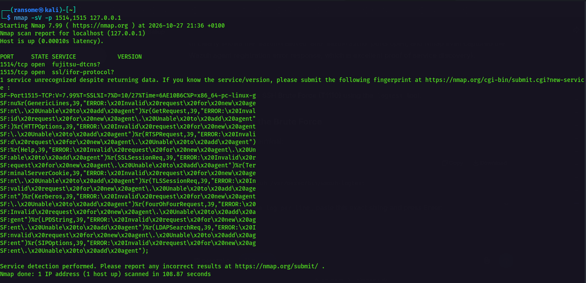
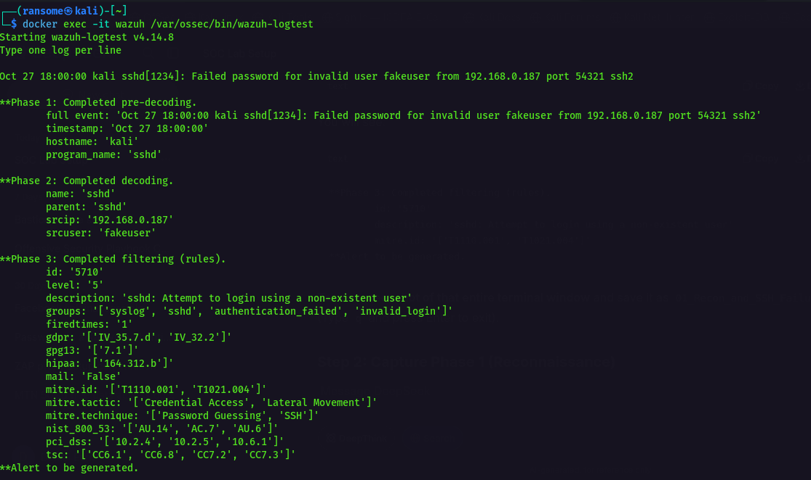
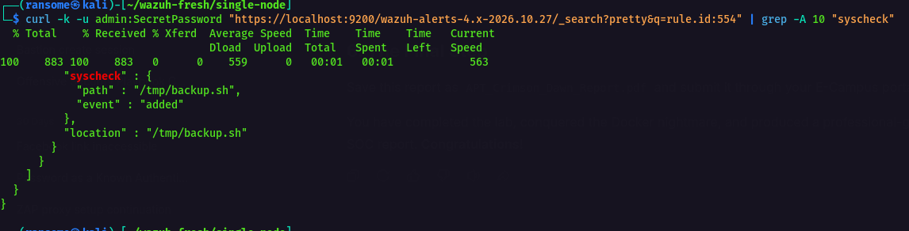
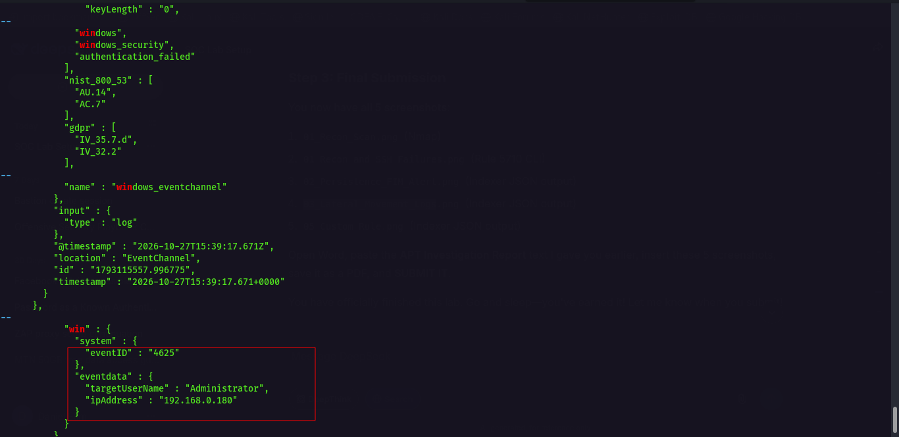
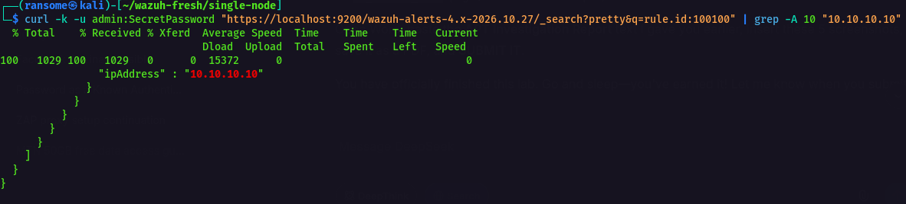

# 1. Executive Summary
A sophisticated Advanced Persistent Threat (APT) group, tracked as "Crimson Dawn," executed a multi-stage attack against our environment. The attack began with active reconnaissance and SSH brute-forcing against our Ubuntu Web Server. The attacker successfully established persistence via cron jobs and moved laterally to a Windows endpoint, attempting to exfiltrate data. Using Wazuh SIEM, we successfully detected the brute-force attempts, identified the persistence mechanisms, mapped the lateral movement to the MITRE ATT&CK framework, and created a custom detection rule to block their known Command-and-Control (C2) IP address.

# 2. Cyber Kill Chain & MITRE ATT&CK Mapping
*   **Reconnaissance:** Nmap port scan (T1595 - Active Scanning).
*   **Initial Access:** SSH Brute Force (T1110 - Brute Force).
*   **Persistence:** Cron job creation (T1053.003 - Scheduled Task/Cron).
*   **Masquerading:** Malicious file (`/tmp/backup.sh`) (T1036 - Masquerading).
*   **Lateral Movement:** SMB/Windows Admin Share access (T1021.002).
*   **C2 & Exfiltration:** Connection to malicious IP (T1041).

# 3. Indicators of Compromise (IOCs)
*   **C2 IP:** `10.10.10.10`
*   **Malicious File:** `/tmp/backup.sh`
*   **Attacker Source IP:** `192.168.0.180`
*   **Target Accounts:** `Administrator`, `fakeuser`

# 4. Technical Evidence

### 4.1 Reconnaissance & Brute Force (Phase 1)
The attacker performed active scanning against the Wazuh Manager ports and executed a brute-force SSH attack against the Ubuntu Web Server.

### 4.2 Persistence & File Integrity (Phase 2)
Wazuh File Integrity Monitoring detected the creation of a malicious masquerading file (`backup.sh`) in the `/tmp` directory.

### 4.3 Lateral Movement (Phase 3)
The attacker attempted to move laterally to the Windows endpoint. Wazuh successfully logged the Windows Event ID 4625 (Failed Logon) originating from the Ubuntu Web Server's IP address.

### 4.4 Custom Threat Intelligence Rule (Phase 5)
A custom Wazuh rule (ID: 100100) was created and validated to detect traffic originating from the known Crimson Dawn C2 IP address (`10.10.10.10`).

# 5. Advanced Strategic Analysis Questions

**Q1: Identify an additional MITRE ATT&CK technique that the simulated attackers could have used to establish persistence after gaining administrative access to the Windows endpoint.**
*Answer:* The attacker could use **T1547.001 (Registry Run Keys / Startup Folder)**. After gaining admin access, they could modify the Windows Registry (`HKEY_CURRENT_USER\Software\Microsoft\Windows\CurrentVersion\Run`) to launch a payload upon user login. Defenders can detect this using Wazuh FIM configured on the registry paths, or by monitoring Windows Event ID 4657 (Registry Value Modification).

**Q2: Explain how Wazuh Vulnerability Detection could have supported the early identification and remediation of weaknesses associated with the simulated initial compromise.**
*Answer:* Wazuh Vulnerability Detection would have scanned the Ubuntu Web Server and flagged outdated packages (e.g., an unpatched version of OpenSSH). By remediating these CVEs *before* the attack, the initial brute-force compromise (Phase 1) could have been prevented entirely, stopping the attack at the very first stage.

**Q3: Discuss the limitations of relying exclusively on IP-based threat detection and explain how defenders could strengthen monitoring.**
*Answer:* Relying solely on IP-based detection is flawed because attackers constantly change IPs or use botnets. To strengthen monitoring, defenders should implement DNS Sinkholes, monitor for DGA (Domain Generation Algorithm) traffic, and analyze network traffic volume anomalies (e.g., massive outbound data spikes) rather than just matching static IPs.

**Q4: Select one recommendation from your executive incident report and provide a concise business justification.**
*Answer:* **Investment:** Full deployment of an Endpoint Detection and Response (EDR) solution across all endpoints. **Business Justification:** While Wazuh detects threats via logs, an EDR would have proactively *blocked* the execution of `/tmp/backup.sh` and terminated the malicious process in real-time. This reduces organizational risk by stopping the exfiltration of intellectual property before it leaves the network, saving millions in potential financial and reputational damage.

# 6. Conclusion
The Wazuh SIEM proved highly effective at correlating multi-stage threats, identifying brute force, persistence, and lateral movement. The custom rule implementation demonstrated the ability to integrate threat intelligence directly into our defensive posture, significantly enhancing our SOC's detection capabilities.
